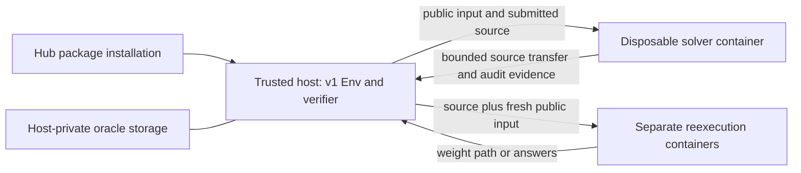

# Hub installation and the numeric-taskset trust boundary

Checked against current official primary sources on 2026-10-25. This describes
what the source/docs establish and what this repository has actually tested.
No Hub package or evaluation was published in P2c.

## Installation and execution are separate

The [official Verifiers overview](https://github.com/PrimeIntellect-ai/verifiers/blob/v0.3.1/docs/v1/overview.md)
describes the Hub as a collection of installable tasksets. Tasks combine public
wire data with lifecycle/scoring behavior; an agent combines a harness, model and
runtime policy. The [Prime CLI guide](https://github.com/PrimeIntellect-ai/prime#environments-hub)
documents browsing, inspecting and installing environment packages locally.
Installation therefore supplies executable taskset code, not by itself a
particular isolation configuration.

The [pinned v1 evaluation guide](https://github.com/PrimeIntellect-ai/verifiers/blob/v0.3.1/docs/v1/evaluation.md)
selects execution runtime explicitly in configuration and permits a taskset/Env
pairing. Its ordinary command is `eval`; the locally installed wheel's `vf-eval`
entry point is legacy. Configuration and installed package versions matter.
These sources do not establish a universal Hub-managed sandbox that silently
reproduces our Docker flags or protects our host-private directory.

## This repository's supported local path

The installed plugin exports a Taskset, its checked Env and its scripted Harness.
The Env provisions the shared `qi_runtime.CheckedRuntime`; generic runtime or
unsupported harness selections fail closed. A third party needs the pinned
package/dependencies, a local Docker daemon, the immutable test image, and
explicitly provisioned work/private host paths. Installing alone does not prepare
or prove these prerequisites.

There is no oracle-to-container mount. Only a unique public work directory under
`/home/kartik/qi-sandbox` is bound into each container at `/work`. Oracle
provenance lives in `/home/kartik/qi-private`, on the trusted host, and is never
passed to solver or replay containers. Existing sealed manifests are not used by
these dev gates. A release must keep any sealed manifest server-side; it must not
be bundled in a public package.

The shared runtime uses network none, read-only root, no privileged mode, one
declared work mount, dropped capabilities except those needed by the trusted
UID-separated tracer, no-new-privileges, and resource limits. Submitted code runs
as nobody. Public read APIs and commands are traced; source reads reject special
files/symlinks and enforce transfer limits. Solver destruction precedes protected
reexecution, and no submitted code runs in the host verifier interpreter. E5's
host calculator enforces capacity and recomputes financial metrics from weights.
These are repository controls, not assumed properties of every Hub taskset.

The Docker control socket stays on the host. A third party operating that host is
inside the trust boundary and can inspect its own verifier/oracles. Our container
controls do not defend against a malicious host administrator or an owner who
changes the installed package/configuration. Public source also reveals the
synthetic generator and scoring algorithm; no cryptographic secrecy of those
algorithms is claimed.

## Public claims supported by measured artifacts

We may describe a reproducible, synthetic-only, locally validated v1 taskset and
report exactly the gate outcomes, runtime/image/source hashes and limitations
saved in results/logs. We may describe the tested Docker boundary under the
specified trusted-host configuration. We may explain source reexecution,
server-computed metrics, capacity enforcement and scripted adversary outcomes.
A passing finite test set is evidence for those cases, not universal security.

We cannot currently claim a one-click hosted/model evaluation, Prime remote
runtime equivalence, hidden-oracle protection on an untrusted host, unpredictable
replay, independent human labels, real-market validity or training transfer.
Model-backed harnesses are deliberately unsupported here; their provider calls
must later be integrated with the project budget gate. Replay seeds in these dev
gates are deterministic and predictable. E5 holding days is the explicitly
specified stationary-edge accounting approximation, not a capacity/profitability
promise about real assets.

## Uncertainties and required distinctions

Prime's documentation offers remote sandboxes and hosted evaluations, but those
are distinct services from downloading a Hub package. We have not executed this
custom Env remotely and have not established remote mount, filesystem, network,
credential or oracle-staging equivalence. The custom Env currently refuses those
runtime types. This is an explicit compatibility gap, not an undocumented claim
that a remote service will run the local Docker subclass.

The official Prime README uses some legacy CLI terminology while the pinned v1
wheel has a different entry point; our commands are verified against the installed
pin. Future upstream versions or hosted configurations require a new explicit
compatibility review. Publication remains a later owner-approved phase.

## E6 application of the same boundary (P2d)

E6 uses the same local runtime/image and ordinary v1 lifecycle. Only the public
quote feed, audited return observations, listing registry, anchors and action
notices enter its disposable work mount. Planted corruption truth and expected
reconciled tables are computed and retained on the trusted host. The bounded
source is reexecuted on primary and fresh E6 dev inputs; it is never executed
in the host verifier. Saved dev trajectory evidence may contain host truth for
author review; those result files are not solver mounts or sealed manifests.

This supports cross-source accounting tests with synthetic corruptions, not
a claim to infer unknowable prices from a single damaged feed or detect every
real-world anomaly. The deliberately event-rich selection, stable listing IDs,
independent public audit observations and strict anomaly transform are material
task assumptions. All earlier trusted-host, predictable-replay, unsupported
model/remote evaluation and publication limits remain. This addition changes
no upstream compatibility claim and relies on the official sources above.
